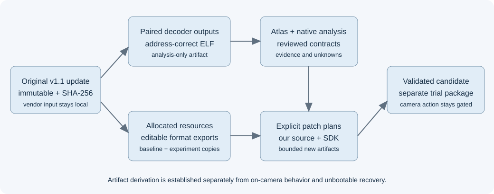
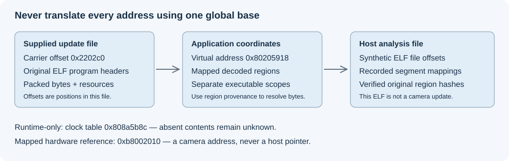

# Architecture and evidence

The arrows show artifact derivation. They do not claim that the host analysis
ELF boots on the camera. The real firmware also includes device initialization,
runtime memory and calibration outside the available update's demonstrated
coverage.

## Carrier, executable and runtime addresses differ

| Coordinate | Example | Interpretation |
| --- | --- | --- |
| Carrier offset | `0x2202c0` | Position in the supplied update file |
| Original ELF representation | One of six parsed ELF files | Headers and file-backed bytes belonging to that artifact |
| Application virtual address | `0x80205918` | Address used by recovered application instructions |
| Analysis ELF file offset | Stored in each region manifest | Where a virtual region is placed in the synthetic host-analysis image |
| Runtime-only address | `0x808a5b8c` clock table | Not present in the file-backed map; contents must not be fabricated |
| High mapped address | `0xb8002010` DRAM selector reference | Static register/memory reference, not a host-process pointer |

Always use the region map to translate coordinates. Adding a single global
base to every offset is wrong. The separate updater can overlap application
virtual addresses; its symbol name must not be assigned to an application
function solely because the numeric address matches.

## The application and the camera lifecycle

The compiled image contains ThreadX/FileX and Zoran-family identifiers, device
initialization, UI handlers, camera state, image commands, storage and update
code. Those identifiers identify software families; they do not establish the
exact fitted processor, sensor or RAM.

For a photo feature, follow the entire path: control selection, state change,
processing command, active capture context, buffer ownership, encoding and the
saved JPEG. A changed preview is not sufficient evidence for a saved-photo
feature. A settings byte changed in RAM is not sufficient evidence of
power-cycle persistence.

## Evidence levels

| Level | What it supports | What it does not support |
| --- | --- | --- |
| Source-bound parsed bytes | Layouts, hashes, decoded instructions and format checks | Runtime reachability or hardware state |
| Reviewed static contract | Specific arguments, branches, field accesses and effects | Complete semantics beyond the reviewed boundary |
| Decompiler inference | A readable model of compiled behavior | Recovered original C, exact types or proof of execution |
| Host/native test | The tested algorithm or tool behavior on that host | On-camera speed, battery life or frame-buffer compatibility |
| User camera observation | The reported behavior for the identified trial | Arbitrary patch reliability or unobserved steps |
| Captured camera artifact | A copied/hash-checked saved file or bounded trace | Unrelated mode ownership or hidden stages |

The static atlas includes all known unwind ranges, not every possible function.
Strings, pointer words and short instruction-pattern references are candidate
leads. Indirect calls and unidentified code remain explicit. The logical
resource filesystem extends beyond the supplied file; absent bytes are not
filled in merely to make a volume appear complete.

## Four memory numbers that must not be confused

The approximately 42 MB image store is not a RAM measurement. A nominal 32 MiB
loop in a NAND monitor is not measured flash geometry. The 8..256 MiB DRAM
selector cases are supported configurations, not an installed-size result. A
4608 by 3456 RGB8 frame mathematically takes 47,775,744 bytes before stride or
scratch, but that calculation does not prove RGB8 is the camera's actual
capture format or that this much RAM is available.
