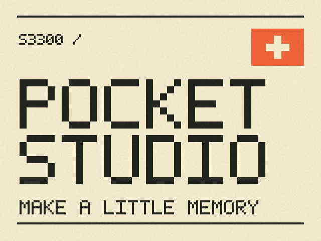

# Pocket Studio startup identity

Original artwork generated from the repository's pixel glyphs and rectangles
in `tools/build_startup_asset.py`. The SVG is editable source geometry; the JPEG
is the exact-size reviewed camera-resource experiment. No Nikon artwork is
included here. Cream background, dark pixel lettering and an orange viewfinder
corner are intended for the old compact-camera character.

`pocket-studio.jpg`: 24,210 bytes, SHA-256
`d003134ffe03c7f4ceb54bb58219d75c451f0bb16eebf0a4294c8d3bd22a14b4`.
It is baseline 640×480 RGB JPEG, 4:2:2, with no padding or trailing payload.

This is a startup image, not a shooting filter, UI theme or performance change.
The firmware candidate is kept local; the art and its source are shareable.
See [trial notes](../../notes/pocket-studio-trial.md).
